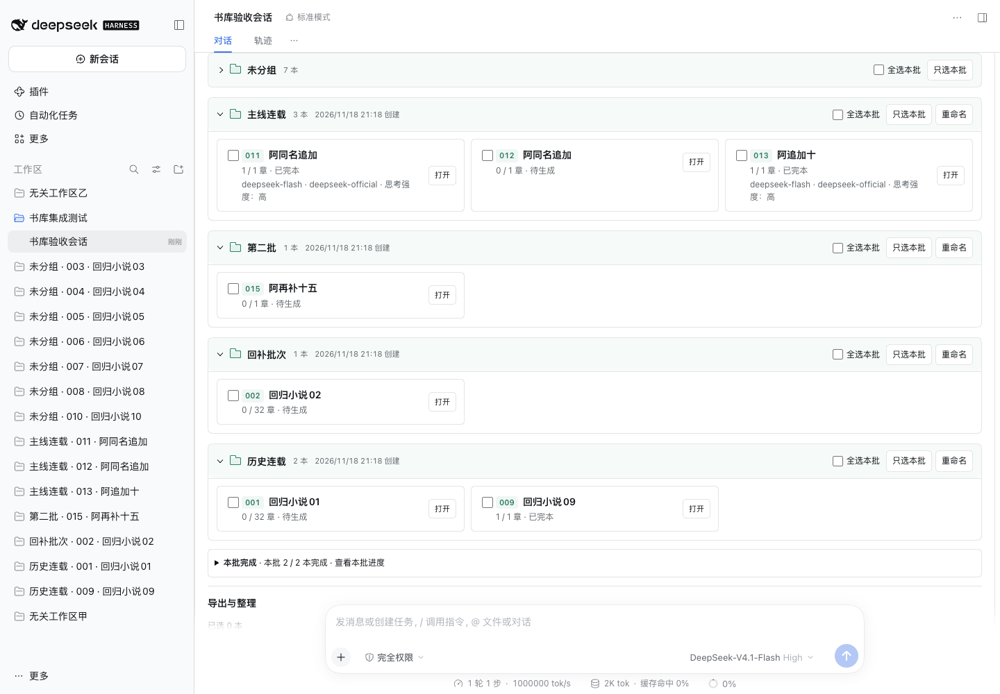

# 长篇连载工作台 · DeepSeek Harness 插件

把已经完成的「最终输出／超级大纲」逐章写成小说。以原绿色版工作台和原版生成、修订提示词为基础，运行在官方 DeepSeek Harness 内。

- 批量勾选导出 TXT：每章一个 TXT、每本书一个 ZIP，批量下载总包；支持选择已完本、未完本导出和失败说明。
- 勾选后直接删除，书立即从列表消失；后台自动停止选中书的生成并清理目录，其他书继续运行。
- 每次导入新书，默认新建「第一批」「第二批」这样的书库文件夹。可以自行命名、追加到已有文件夹，或勾选旧书批量归档。每本书有独立工作区。
- 每个书库的新书按导入批次追加并固定编号 001、002……；卡片与导出书包使用同一编号，筛选、删除或只导出部分书都不重新编号。
- 书库中可折叠文件夹或勾选整组。Harness 侧栏以「文件夹 · 书号 · 书名」显示书籍。在「整理顺序」中可拖动同一文件夹里的书。
- 单本一键续写 10／20／50 章或全本。
- 书间默认全部同时生成，也可自定义正整数并发数，不设固定上限；同书逐章串行。
- 正文超过1500字即可通过字数验收，无上限；首次失败后自动重试5次。
- 先勾选书，再批量新增 10／20／50 章或写至完本；也可明确选择全部可新增的书。
- 单独暂停或继续所选书，其他书继续；已有批次沿用原目标，新书可加入正在运行的队列。
- 正文验收后，独立调用模型执行作者提供的标题提示词：根据本章拟 5 个 15—25 字候选，全部编号放在每章 TXT 开头，发布时自行选择；标题失败不重写正文。
- 每章带入本书完整文风、前 10 章正文全文，使用新的原生会话。
- 单书与书库启动前可选本批写作模型、该模型支持的思考强度；默认带入当前会话配置，可改选，按界面显示值启动并保存；正文与独立标题使用同一选择，暂停恢复保留原批设置。
- 模型列表来自 Harness 原生配置；可在运行中为新加入的书选其他模型，不改变已有书的模型或主会话设置。



## 安装

1. 安装 [官方 DeepSeek Harness](https://deepseek.com/harness/)。当前验证版本为 **0.2.2-rc.3**。
2. 在 Harness「插件 → 添加插件 → 包名或地址」粘贴下面的公开插件安装直链：

```text
https://github.com/HeyFagao/long-serial-harness/releases/download/v0.1.26-serial.11/oh-story-dsh-0.1.26-serial.11.tgz
```

3. 安装后保存当前工作并重新打开 Harness。在「设置 → 模型」添加自己的中转站和模型；在工作台「写作模型」选择本批模型与适用的思考强度。
4. 首次使用时添加一个空文件夹工作区作为书库。升级后直接打开原来的书库，已有书可在「未分组」中整理。

仓库和发布附件均已公开，无需 GitHub 登录。网络无法直接安装时，从 [v0.1.26-serial.11 发布页](https://github.com/HeyFagao/long-serial-harness/releases/tag/v0.1.26-serial.11) 下载 `long-serial-partner-0.1.26-serial.11.zip` 并解压，按包内说明运行安装脚本或使用本地 `.tgz` 完整路径。不要把源码仓库根目录当作插件安装包。

## 使用与验证

[使用说明](docs/使用说明.md) · [中转站设置](docs/中转站设置.md) · [验收记录](docs/验收记录.md) · [来源说明](docs/来源说明.md)

本版的文件夹流程实测、安装包哈希及历版回归记录见 [验收记录](docs/验收记录.md)。四类中转协议的独立收据来自 serial.3，属于历史验证。**真实付费长批次及文学质量尚未验收。** 电脑与 Harness 需持续运行；退出后重新打开原项目并恢复。

不包含 API 密钥、用户小说原稿或本机配置。原系统提示词及状态约定保留在插件内；无剧本、游戏、视频工作台。源码开发方式见 [源码说明](README-SOURCE.md)。

基于 [zenstory-ai/oh-story-dsh](https://github.com/zenstory-ai/oh-story-dsh) 0.1.26 的原生插件与文件工作台基础（MIT），为专用派生版本，非上游官方发行。
